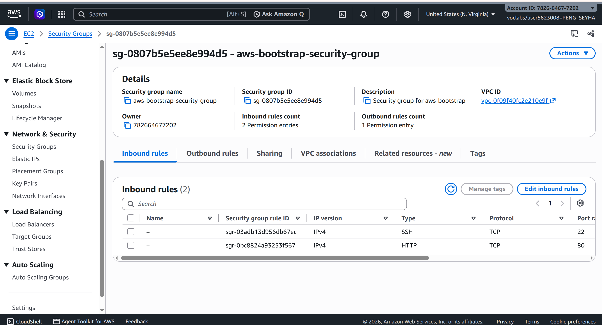
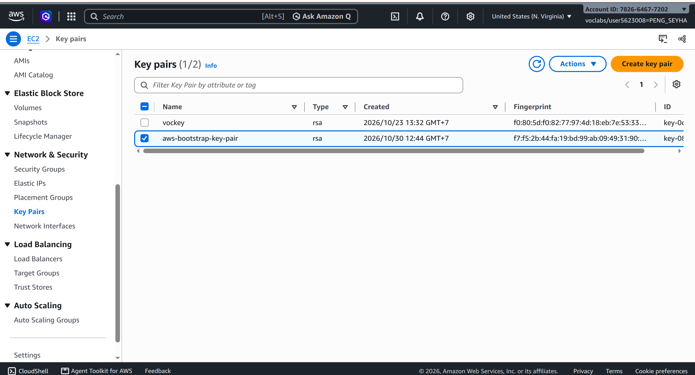
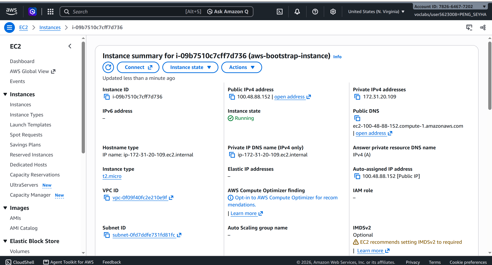
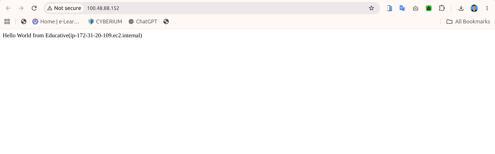
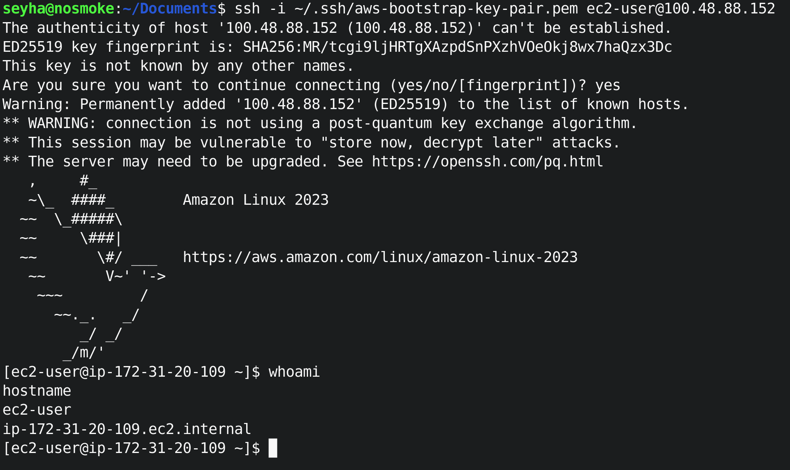
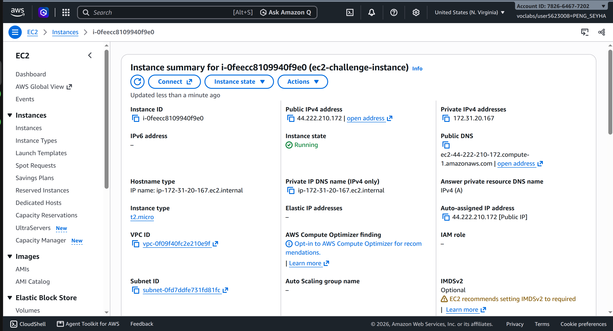
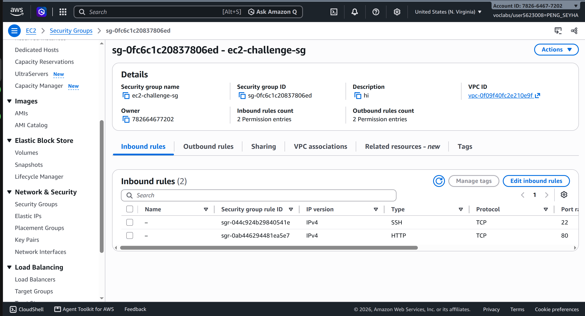
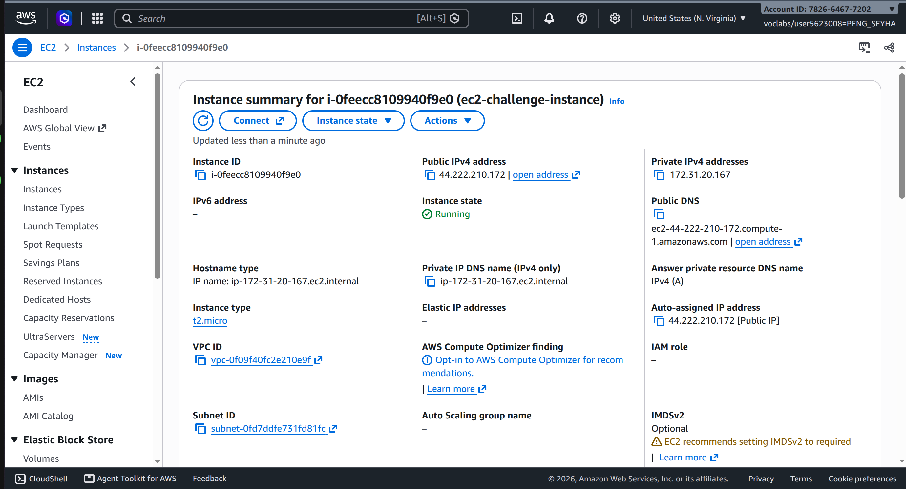
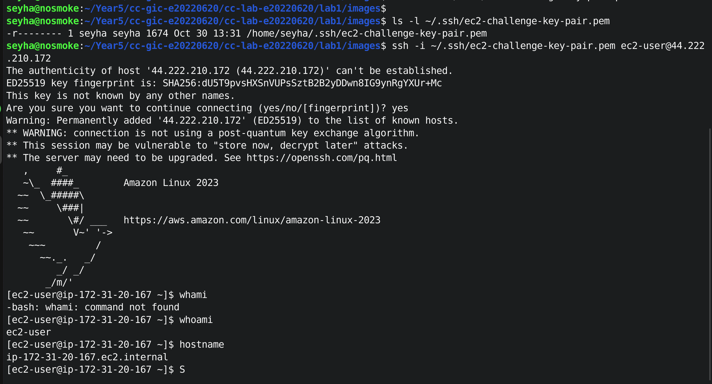

# Cloud Lab 1 — Amazon EC2

- **Student Name:** Peng Seyha
- **Student ID:** e20220620
- **Learner Lab Username:** `voclabs/user5623008=PENG_SEYHA`
- **Date:** October 30, 2026

---

## Part 1.1 — Amazon EC2 Walkthrough

### 1. Security Group

Created `aws-bootstrap-security-group` with SSH (22) and HTTP (80) inbound rules.



### 2. Key Pair

Created `aws-bootstrap-key-pair` using RSA and downloaded the `.pem` file.



### 3. EC2 Instance

Launched an EC2 instance with Amazon Linux 2023, `t2.micro`, and 8 GiB storage.



### 4. Browser Test

Opened the public IP in a browser and successfully displayed the Hello World page.



### 5. SSH Connection

Connected to EC2 using SSH from my Ubuntu terminal and verified the connection using `whoami` and `hostname`.



---

## Part 1.2 — EC2 Web Solution Challenge

### 1. Launch Configuration

Created a Linux EC2 instance using `t2.micro` with a 10 GiB root volume.



### 2. Security Group

Configured SSH (22) and HTTP (80) inbound rules.



### 3. Running Instance

Launched the challenge instance successfully.



### 4. Web Server Installation

Installed Apache and created the webpage using these commands:

```bash
sudo dnf install -y httpd
sudo systemctl start httpd
sudo systemctl enable httpd
sudo systemctl status httpd --no-pager

echo "Welcome to the EC2 Challenge" | sudo tee /var/www/html/index.html

cat /var/www/html/index.html
curl http://localhost
```

**Result:**

```text
Welcome to the EC2 Challenge
```



### 5. Browser Test

The webpage worked locally, but the public IP connection timed out. This step was not completed.

## Part 1.2 — EC2 Web Solution (Challenge)

### Launch configuration


### Security group


### Running instance


### Commands on the instance


Paste the commands you ran to install the web server and create `index.html`:

```bash

```

### Browser test


---
## Questions

1. Your security group has an SSH rule and an HTTP rule. What does each one let you do? What would stop working if you deleted the HTTP rule?
2. In Part 1.1 you never logged in to install the web server. What installed it, and when did it run?
3. Why does the web page open with `http://` but not with `https://`?
4. Part 1.2 asked for a 10 GiB root volume. Where in the launch settings did you set it, and how can you check the size on the running instance?

### Answer

1. What do the SSH and HTTP rules allow? What happens if the HTTP rule is deleted?
The SSH rule (port 22) lets me connect to my EC2 instance remotely. The HTTP rule (port 80) lets me open the web page in a browser. If I delete the HTTP rule, I can still use SSH, but the web page will not open.
2. What installed the web server, and when did it run?
The User Data script installed the web server automatically when the EC2 instance started for the first time. I didn't need to log in and install Apache myself.
3. Why does the web page open with HTTP but not HTTPS?
HTTP works because Apache is serving the page on port 80, which the security group allows. HTTPS doesn't work because it hasn't been configured on the server, and port 443 isn't allowed.
4. Where did you set the 10 GiB root volume, and how can you check it?
I set it to 10 GiB in the Configure storage section when launching the instance. I can check it in the EC2 instance's Storage tab or connect with SSH and run lsblk to see the disk size.
---
