- **Student name:** Peng Seyha
- **Student ID:** e20220620
- **Learner Lab user name:** 
- **Date completed:**

---

## Security groups

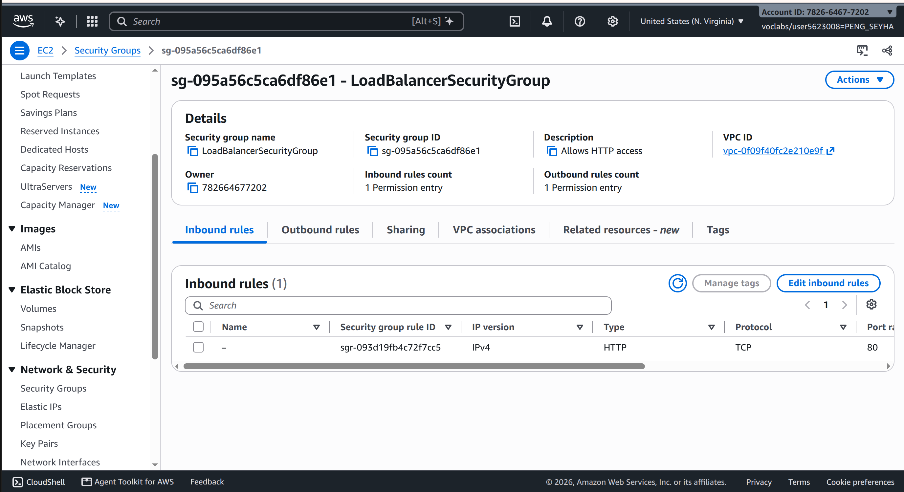

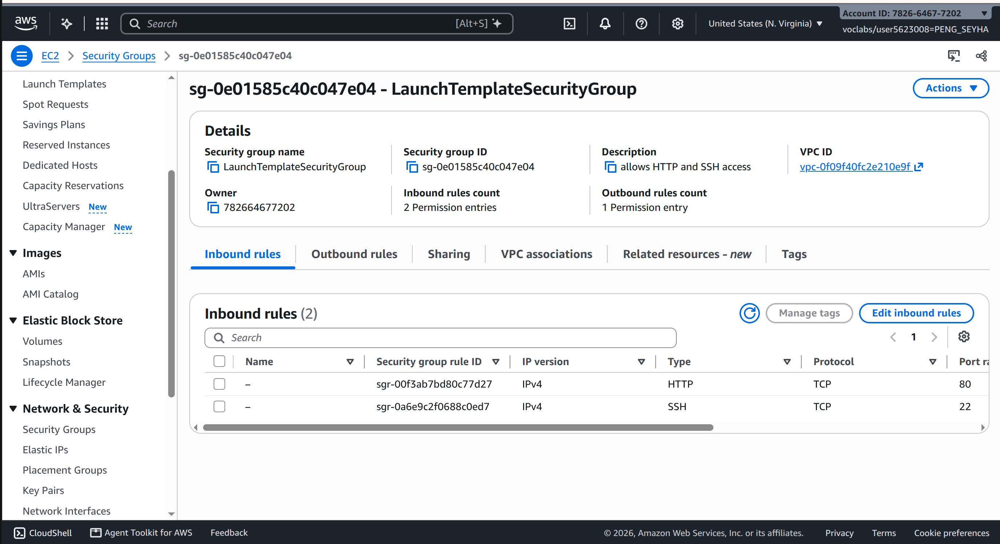

## Target group

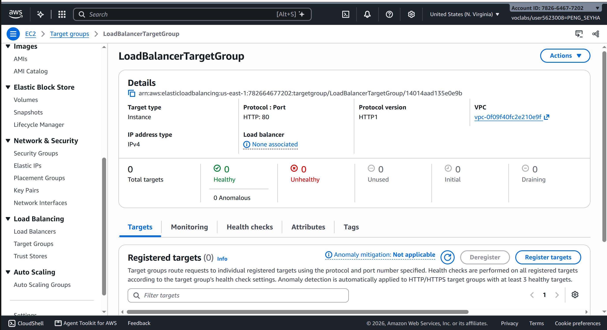

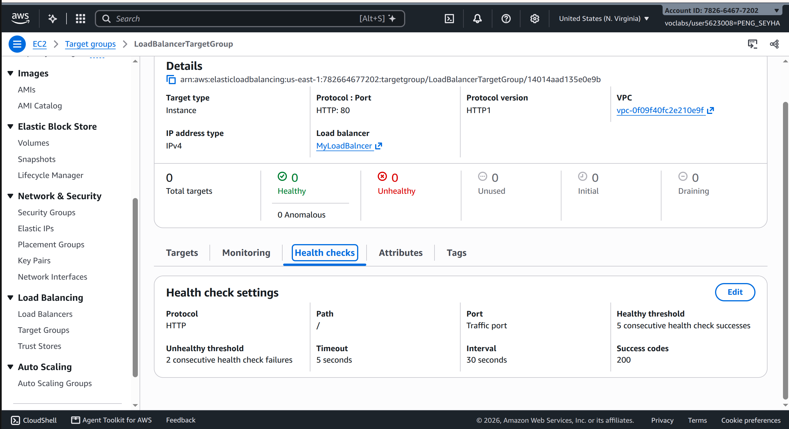

## Application Load Balancer

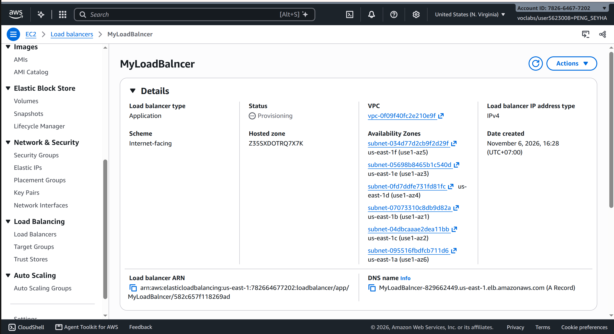

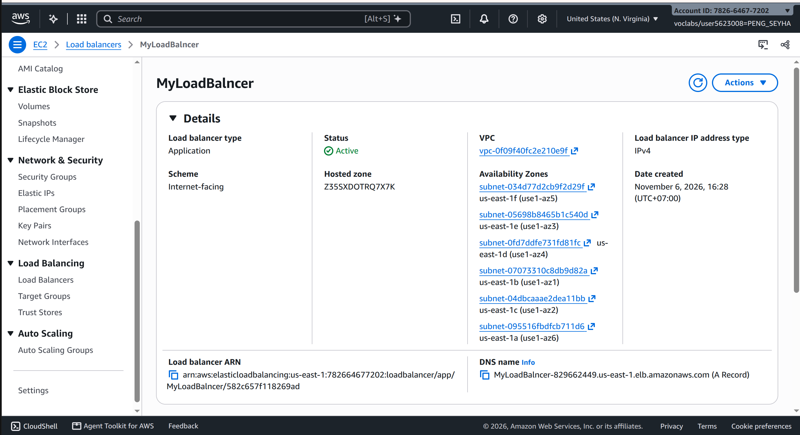

## Launch template

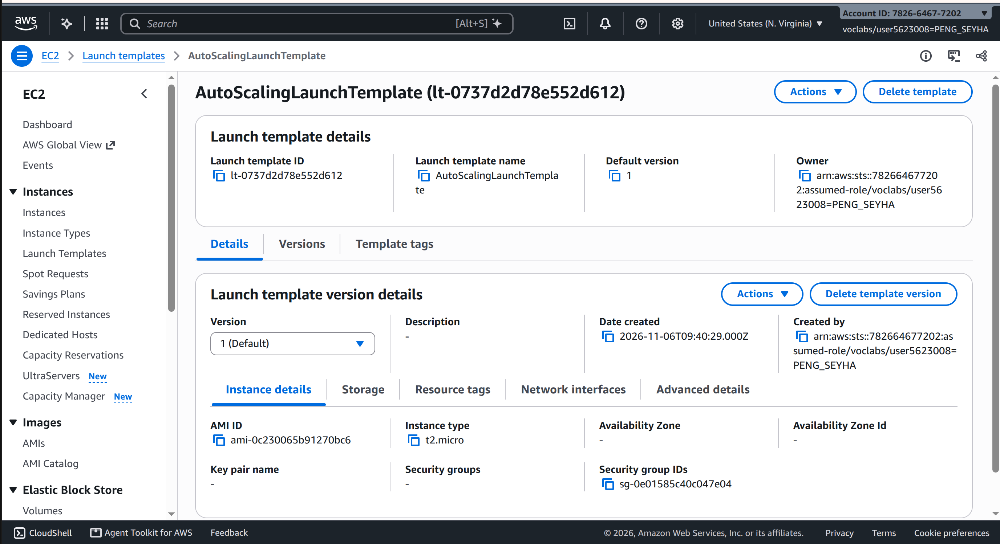

## Auto Scaling group

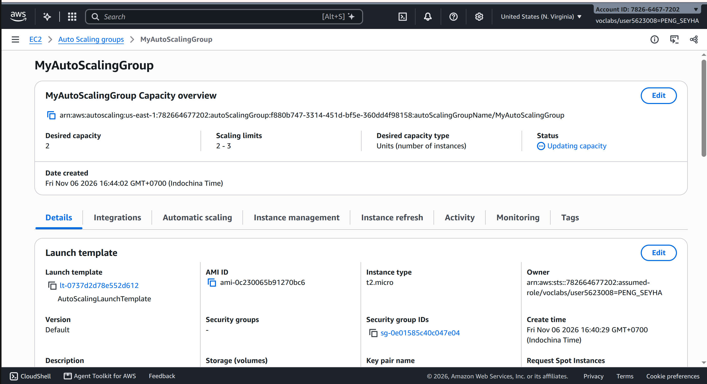

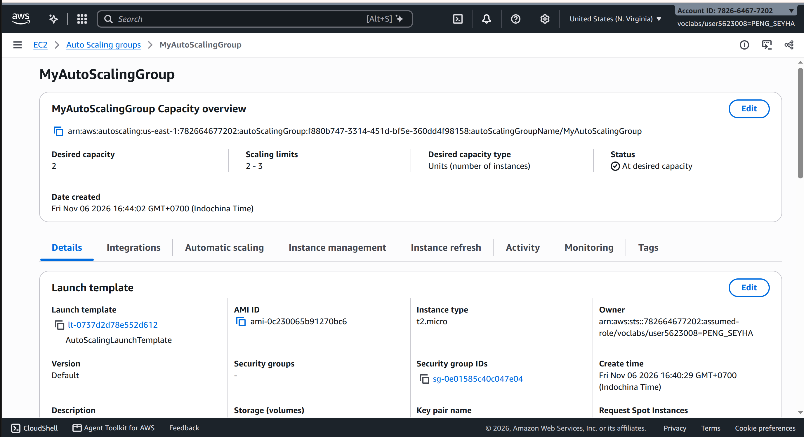

## Load balancing test

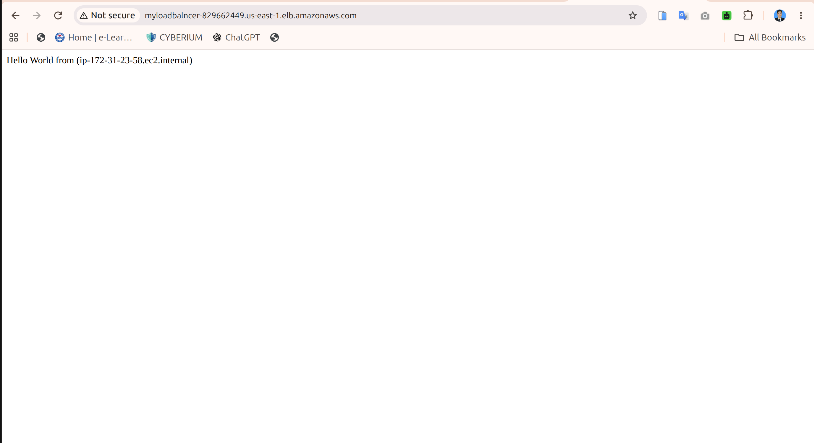

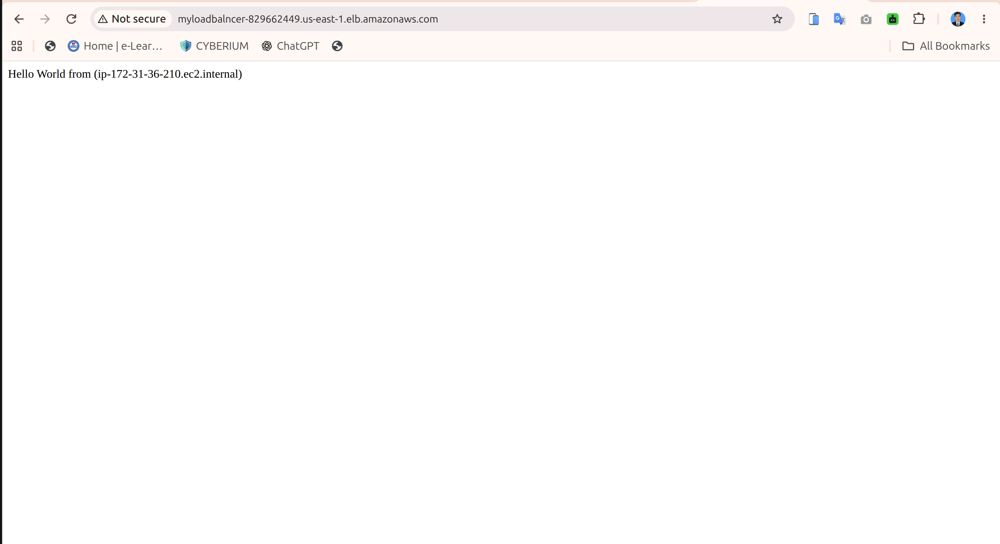

## Simulated application failure

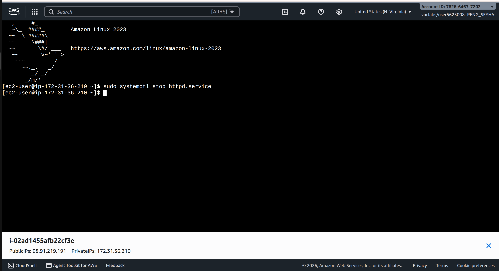

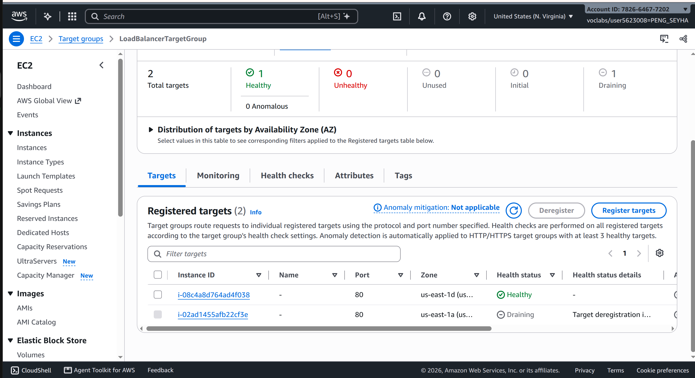

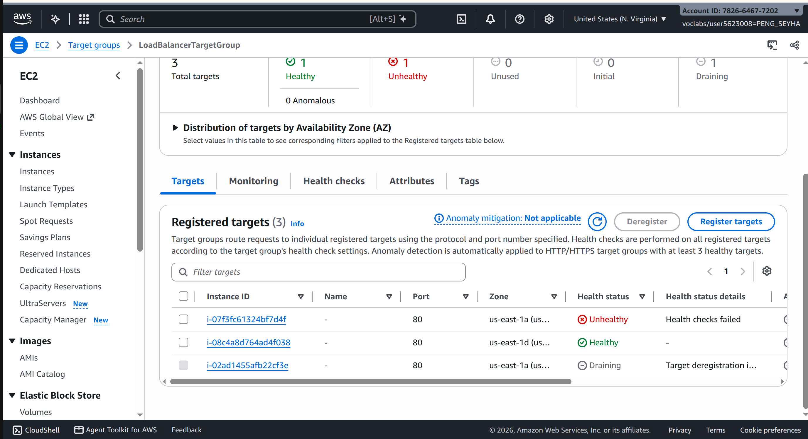

---

