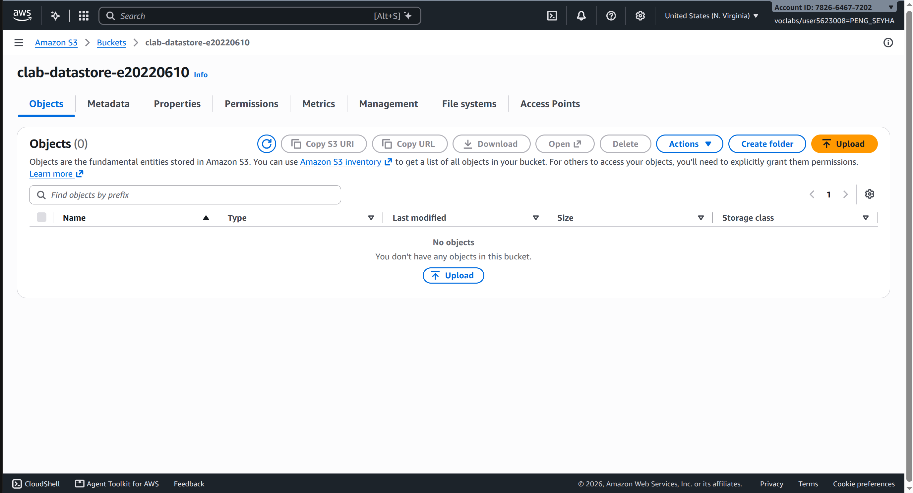
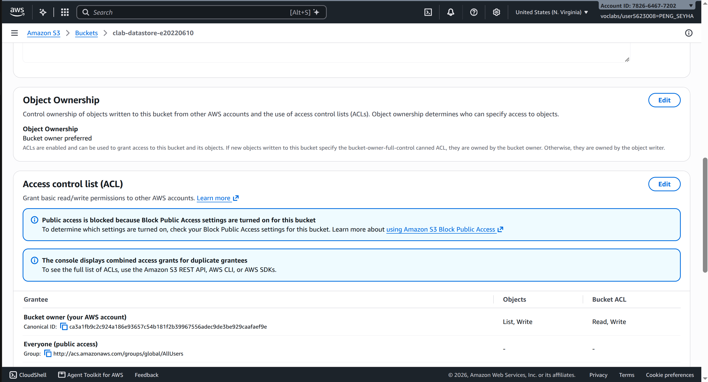
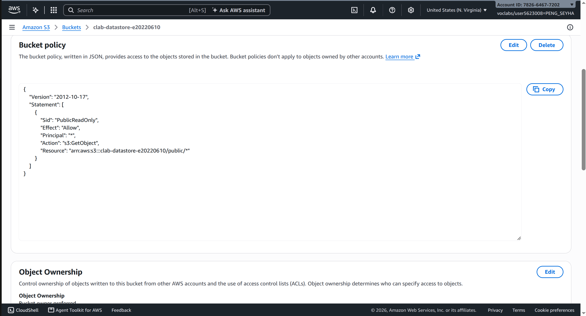
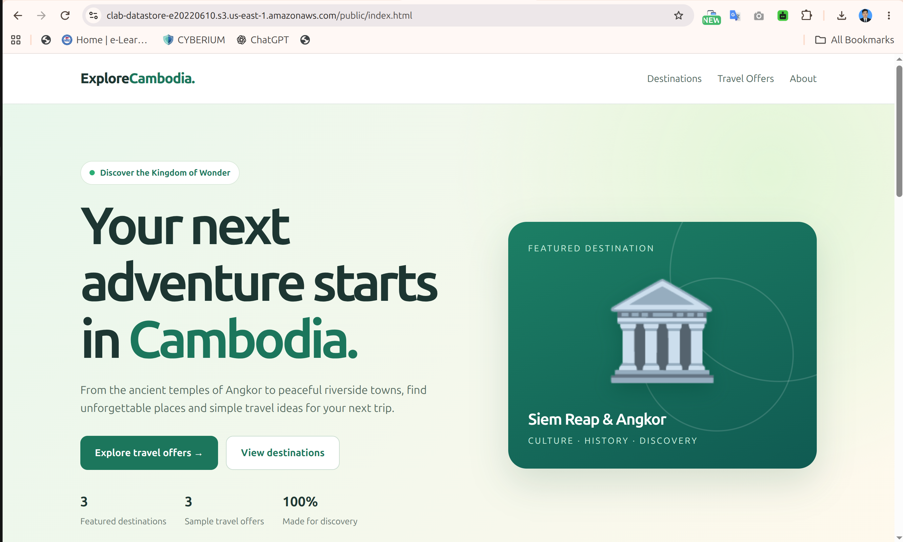
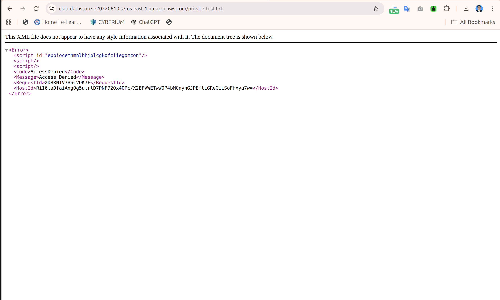
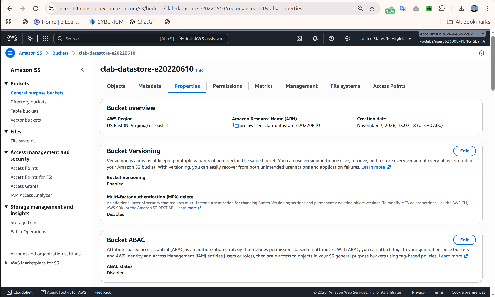
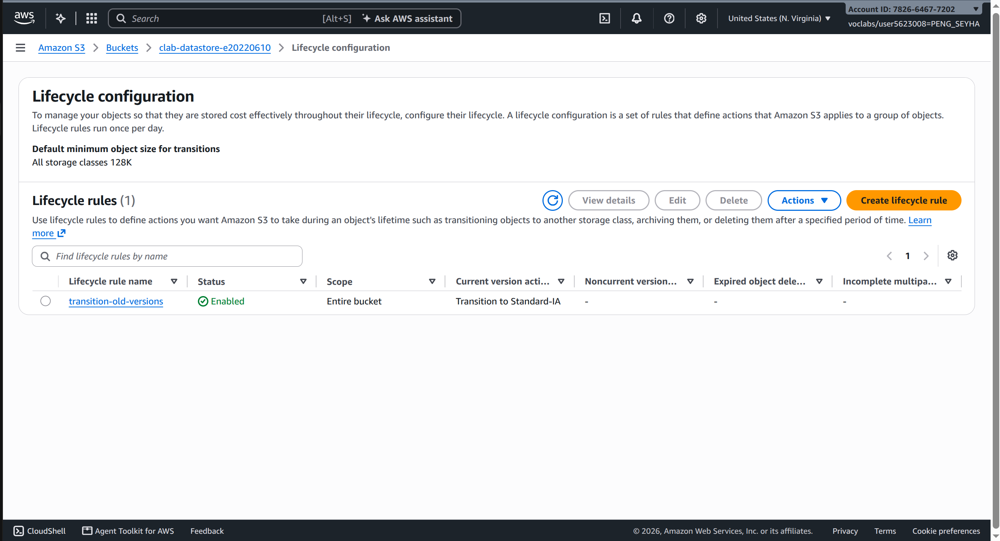

- **Student name:** Peng Seyha
- **Student ID:** e20220620
- **Learner Lab user name:**
- **Bucket name:**
- **Date completed:**

---

## 1. Bucket

## 2. Object ownership

## 3. Public access policy

My policy is in [bucket-policy.json](bucket-policy.json). Explain which line limits public access to the `public/` folder:

## 4. Versioning

## 5. Lifecycle rule

---

## Questions

1. You turned off parts of **Block Public Access** for this bucket. Why was that needed, and why is it still safe for the objects outside `public/`?
2. What is a **noncurrent version**? Give an example from your own test.
3. Why move noncurrent versions to S3 Standard-IA instead of deleting them?

## Answers

1. We disabled the Block Public Access settings for bucket policies to allow public access to files inside `public/`. Other files remain private because our bucket policy only allows `s3:GetObject` for objects under `public/*`. We tested this by opening `private-test.txt` and receiving AccessDenied.

2. A noncurrent version is an older version of a file that is kept when a new version is uploaded with the same name. For example, if we upload an updated `public/index.html` after enabling versioning, the previous version becomes noncurrent while the new version becomes current.

3. We move noncurrent versions to S3 Standard-IA to reduce storage costs while keeping older versions available. This allows us to recover previous files if needed instead of permanently deleting them.
