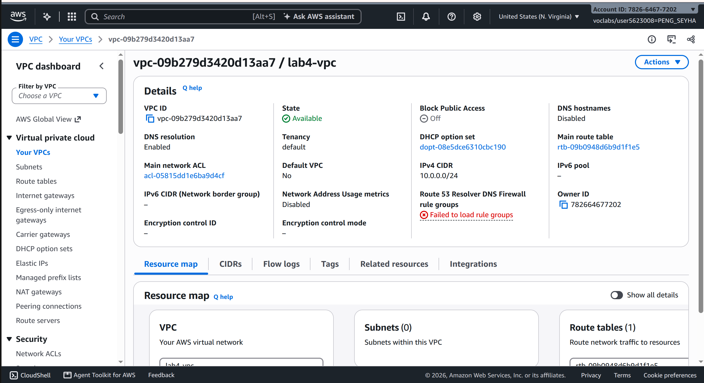
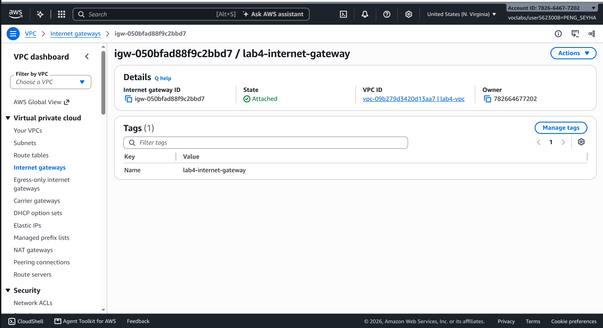
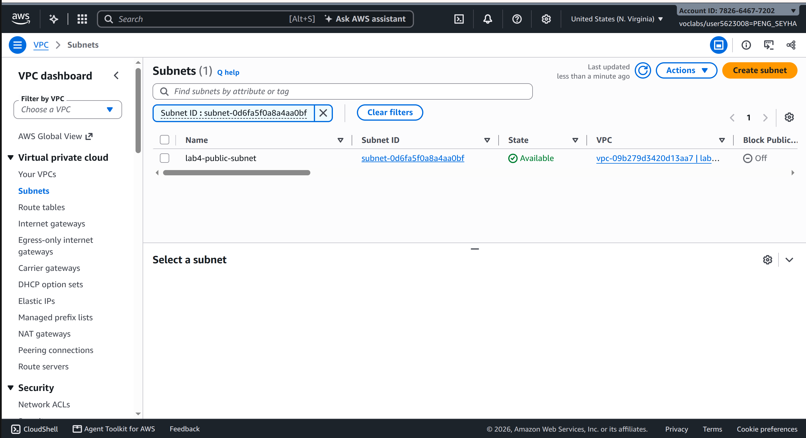
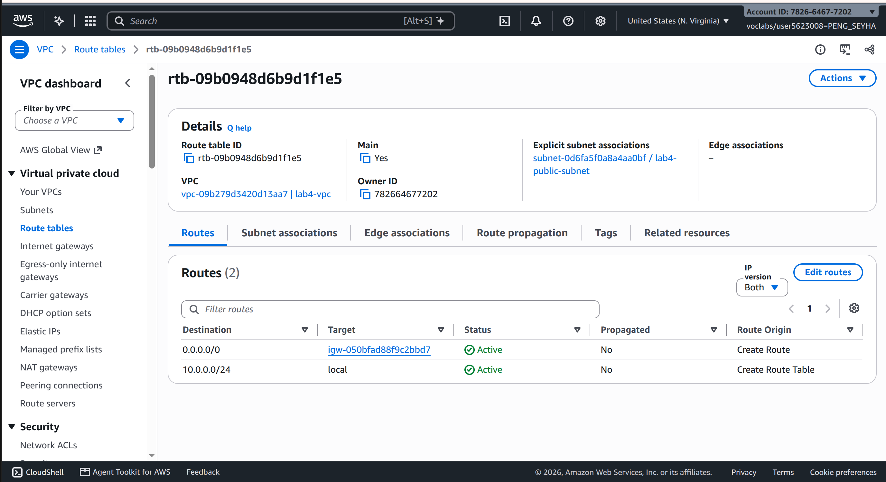
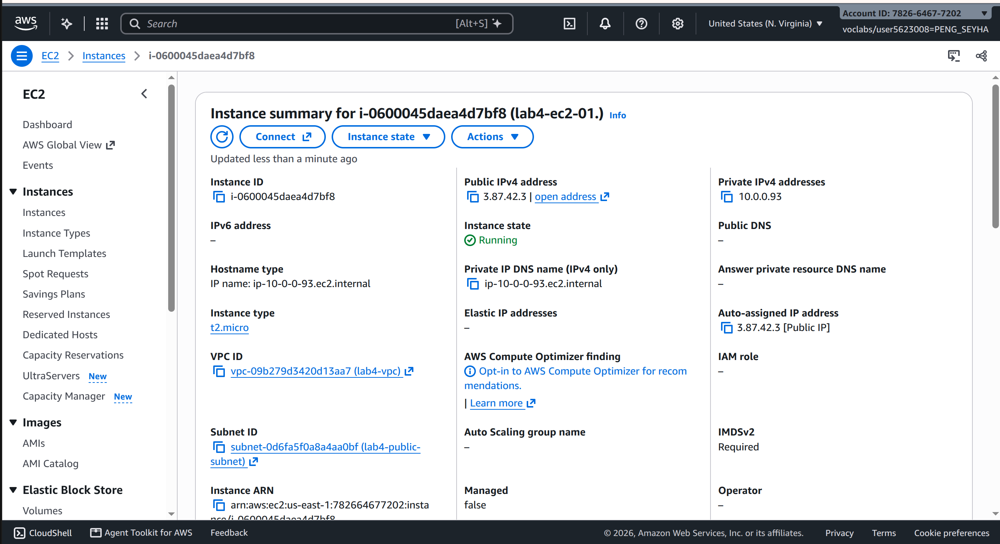
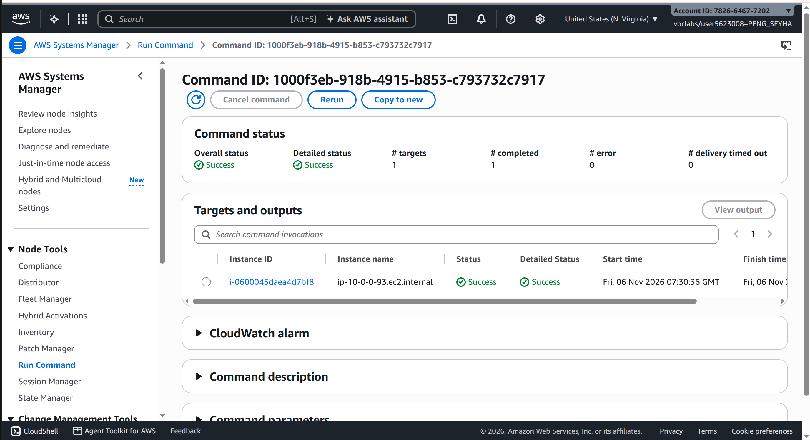
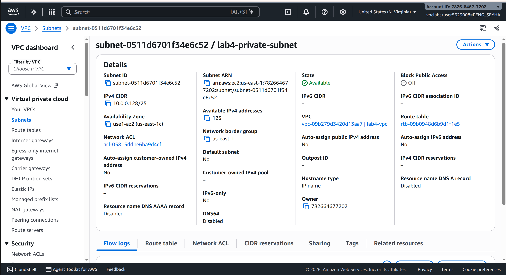
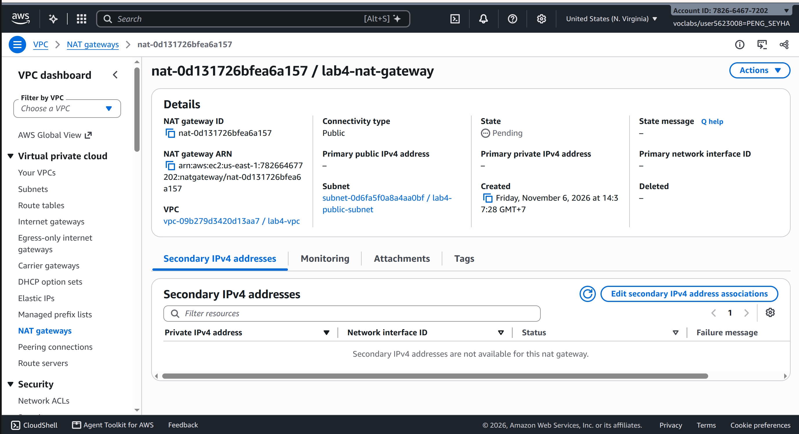
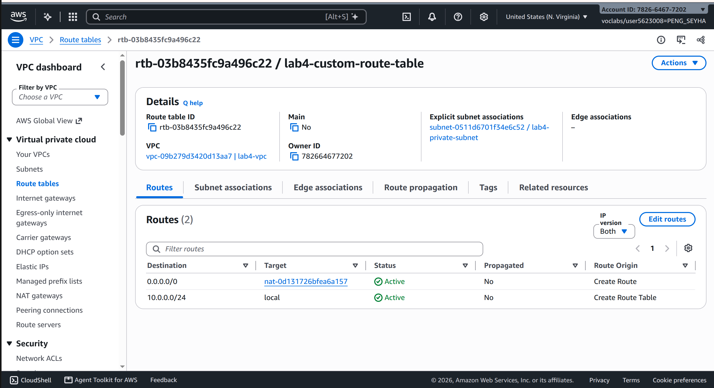
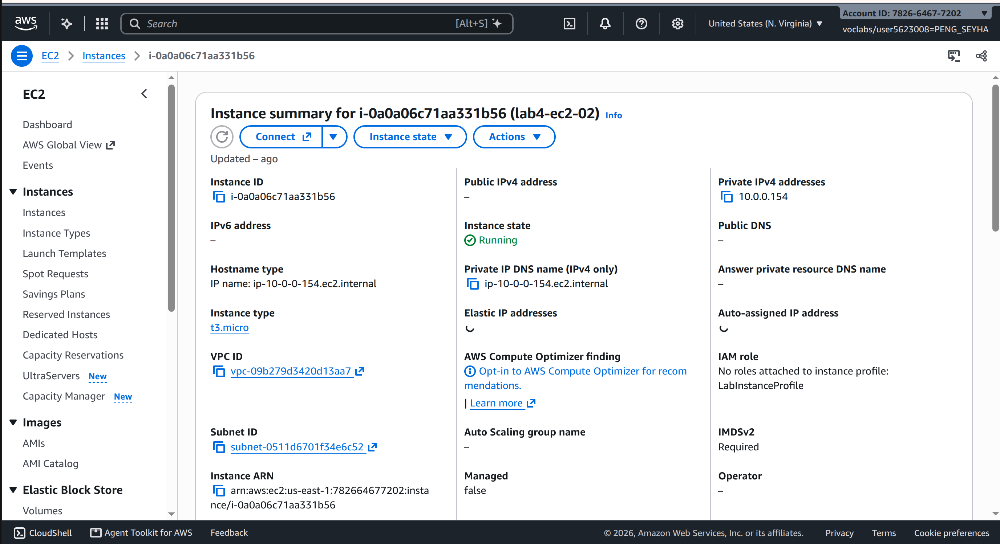

- **Student name:** Peng Seyha
- **Student ID:** e20220620
- **Learner Lab Username:** `voclabs/user5623008=PENG_SEYHA`
- **Date completed:**

---

## VPC and internet gateway

## Public subnet

## Private subnet

## Questions

1. The VPC is `10.0.0.0/24` and the subnets are `10.0.0.0/25` and `10.0.0.128/25`. How many IP addresses does each block contain, and why do the two subnets not overlap?
2. Both subnets are in the same VPC. What exactly makes `lab4-public-subnet` public and `lab4-private-subnet` private?
3. Why is the NAT gateway placed in the **public** subnet and not in the private one?
4. `lab4-ec2-02` has no public IP address. Can someone on the internet open a connection to it? Can it download updates? Explain both answers.
5. You tested internet access with Systems Manager instead of SSH. Why did the instances need `LabInstanceProfile` for this?

### Answers
1. The VPC (10.0.0.0/24) contains 256 IP addresses, and each /25 subnet contains 128 IP addresses. AWS reserves 5 addresses in each subnet, leaving 123 usable. The subnets do not overlap because the first uses 10.0.0.0–10.0.0.127 and the second uses 10.0.0.128–10.0.0.255.

2. The public subnet has a route to the Internet Gateway, while the private subnet uses a NAT Gateway for internet access. This is what makes one subnet public and the other private.

3. The NAT Gateway is placed in the public subnet because it needs access to the Internet Gateway and a public IP address. It allows instances in the private subnet to access the internet.

4. No, someone on the internet cannot directly connect to lab4-ec2-02 because it has no public IP address. However, it can download updates through the NAT Gateway, which allows outgoing internet connections.

5. The instances needed LabInstanceProfile because it gives them the IAM permissions required to communicate with AWS Systems Manager. This allows me to run commands remotely without connecting through SSH.
---
